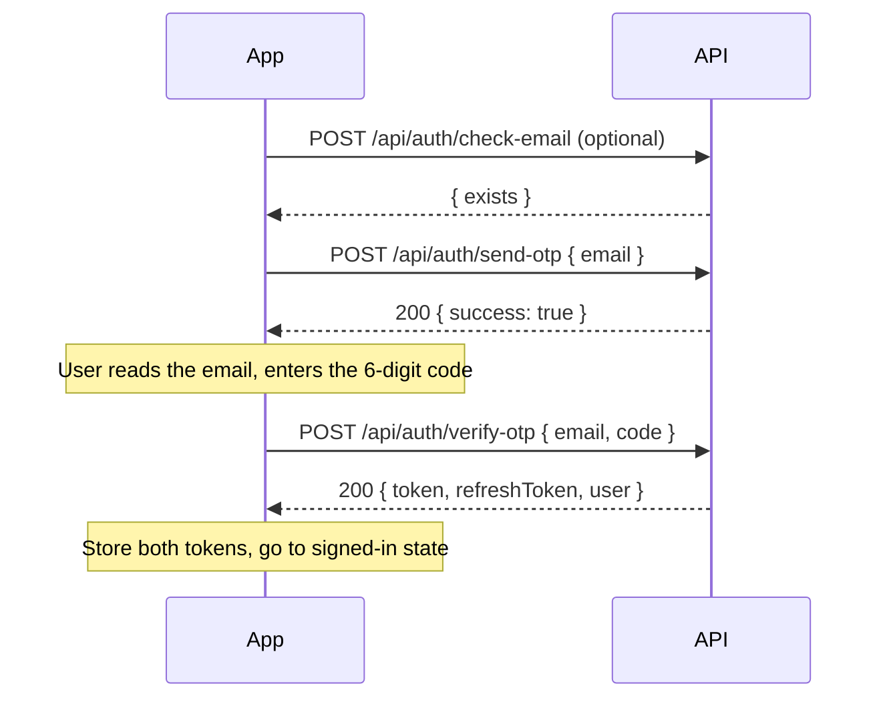
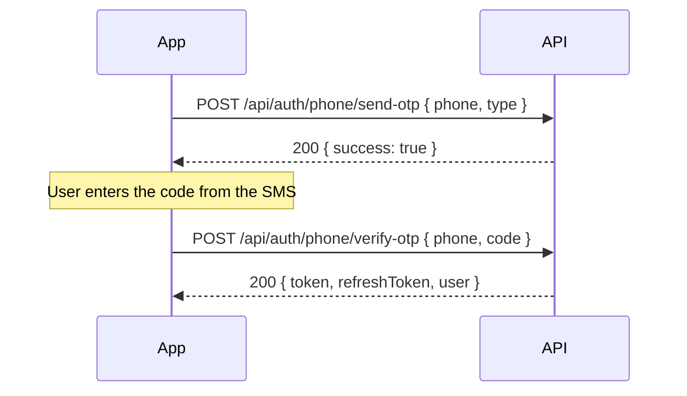
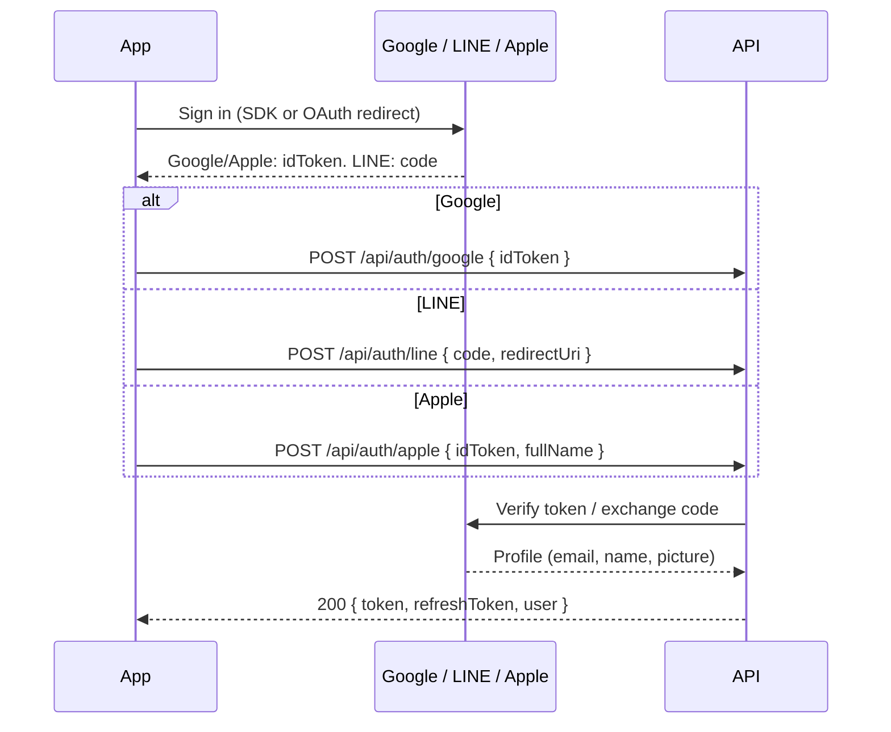
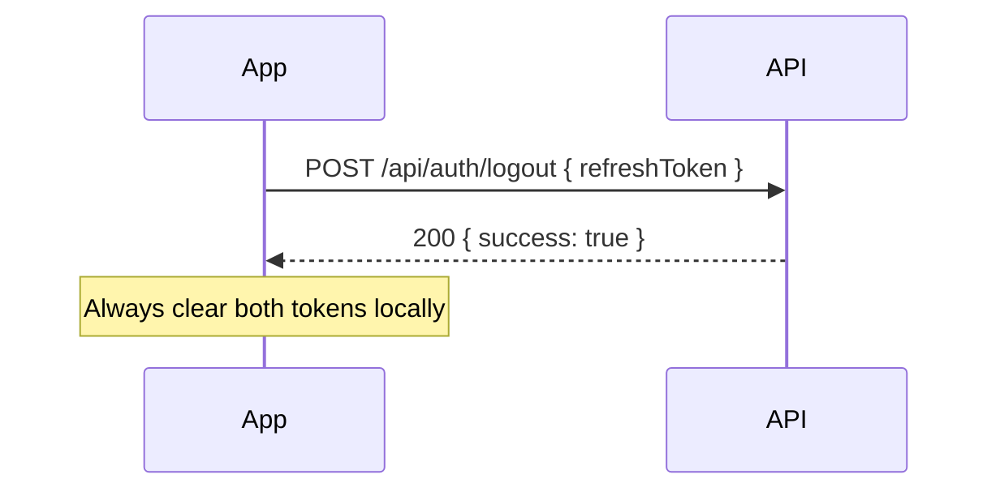
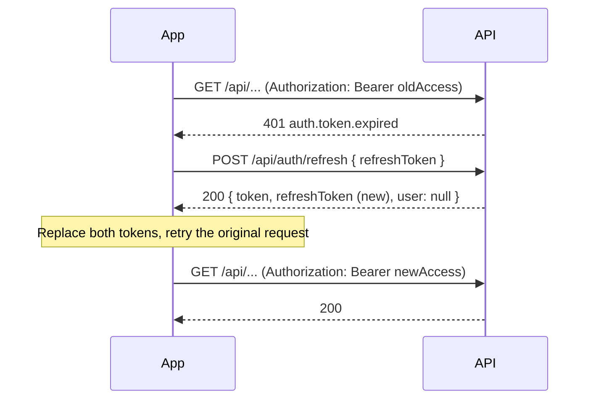

# Auth Flow

Covers Email OTP, phone OTP, Google / LINE / Apple sign-in, refresh, logout, and 401 handling. For each endpoint's fields, types, and error examples, see the **Auth** section in Swagger; this document only describes flows that span multiple APIs. For global conventions, see [conventions.md](conventions.md).

All `/api/auth/**` endpoints are public (no `Authorization`) and are rate limited (see conventions §5).

## 1. Tokens and lifetimes

| Token | Default lifetime | Setting | Notes |
|-------|----------|------|------|
| access token (`token`) | 1 hour | `JWT_EXPIRATION_SECONDS` (default 3600) | JWT, stateless; send as `Authorization: Bearer <token>` to protected endpoints |
| refresh token (`refreshToken`) | 30 days | `JWT_REFRESH_EXPIRATION_DAYS` (default 30) | Opaque string (UUID) stored in server-side Redis; **single use**, every refresh issues a new pair |
| refresh grace window | 10 seconds | `JWT_REFRESH_GRACE_SECONDS` (default 10) | See §6 |

Storage recommendations:

- Web: keep the access token in memory. The refresh token is currently stored by the frontend itself (the API does not set cookies); keep it out of reach of third-party scripts (strict CSP, no untrusted scripts) and never write it to logs.
- App: store both in the system secure storage (Keychain / Keystore).
- On every login or refresh response, **overwrite both** tokens; the old refresh token cannot be used afterwards.
- `user` is only present in login / signup responses. In refresh responses `user` is `null`, so keep the data from login.

## 2. Email OTP login / signup

The same endpoints handle both login and signup: the server decides based on whether the email is already registered, so the frontend does not need to specify it.



| Step | API | Notes |
|------|-----|------|
| 1 (optional) | `POST /api/auth/check-email` | Only used to decide whether the copy says "Log in" or "Sign up" |
| 2 | `POST /api/auth/send-otp` | OTP is valid for 180 seconds by default; resending to the same email has a cooldown (default 180 seconds) |
| 3 | `POST /api/auth/verify-otp` | Success consumes the OTP; a new email automatically creates an account |

Emails are trimmed and lower-cased. A Gmail address (`gmail.com` / `googlemail.com`) also loses its dots and `+tag` and moves to `gmail.com`, so `A.B+news@GoogleMail.com` and `ab@gmail.com` are one account. `user.email` comes back in this canonical form.

## 3. Phone OTP login / signup



- Omitting `type` is the same as `login`; the phone number must then already be registered, otherwise 400 `auth.phone.not_registered`. For new numbers, send `type: "signup"`.
- `verify-otp` has no `type`: if the number does not exist an account is created; if it exists the user is logged in.
- Numbers are stored as E.164 with Taiwan as the default region: a Taiwan mobile number `09xxxxxxxx` or `+` country code and number are accepted, spaces, `-`, `(` and `)` are ignored. `0912345678` and `+886912345678` are the same number, and `user.phoneNumber` comes back as `+886912345678`. Any other format gets 400 `auth.phone.invalid`.

## 4. Google / LINE / Apple sign-in

What the three have in common: the frontend first obtains a credential from the provider, then hands it to the backend in exchange for a JWT. The backend only trusts emails the provider has verified; an unverified email returns 401 `auth.email_not_verified` (to prevent account takeover via an unverified email).



| Provider | Data sent to the backend | Notes |
|----------|----------------|------|
| Google | `idToken` | The audience must be this project's Google client ID |
| LINE | `code` + `redirectUri` | `redirectUri` must match the one used during authorization; if LINE provides no email, the backend uses `line_<userId>@line.oauth` instead, so `user.email` is never `null` |
| Apple | `idToken` + `fullName` | Apple only provides the name on the **first authorization**, so send `fullName` that time; if Apple's key endpoint is down the backend returns 503, which can be retried |

## 5. Logout



- Only the refresh token passed in is revoked; other devices are unaffected.
- An unknown or already-revoked token also returns 200, so the frontend has no failure to handle; always clear the local tokens unconditionally.
- The access token is stateless and technically remains valid after logout until it expires; the frontend must discard it.

## 6. Refresh and rotation



Rotation rules (`RefreshTokenService`):

1. Every refresh **consumes** the refresh token passed in and returns a new access token and a new refresh token.
2. **Grace window (default 10 seconds)**: if the same old refresh token is sent again within the window (e.g. two tabs or two requests refreshing at the same time), it gets **exactly the same new token pair**, without failing and without being treated as an attack.
3. **Reuse detection**: if an old token that was already consumed is sent after the grace window (possibly a leaked token), the backend **revokes all refresh tokens on all of that user's devices** and returns 401 `auth.suspicious_login`. On receiving it, the frontend must clear local tokens, force logout, redirect to the login page, and show a message like "For your security, all devices have been signed out. Please log in again."
4. Refresh reloads the user's latest roles, so role changes take effect after the next refresh (at most one access token lifetime).
5. If the user does not exist or is suspended, refresh returns 401 `auth.refresh_token.invalid` and revokes all of that user's refresh tokens.

## 7. 401 handling strategy

The `errorCode` decides the action (do not look at the status alone):

| errorCode | Source | Action |
|-----------|------|------|
| `auth.token.expired` | Protected endpoint | Refresh once, then retry the original request on success |
| `auth.token.invalid` | Protected endpoint | Clear tokens, redirect to the login page |
| `common.unauthorized` | Protected endpoint (no token sent) | Clear tokens, redirect to the login page |
| `auth.refresh_token.invalid` | `/api/auth/refresh` | Refresh token is invalid or expired; clear tokens and redirect to the login page |
| `auth.suspicious_login` | `/api/auth/refresh` | Same as above, plus show a security notice |

**Single in-flight refresh**: several requests may receive `auth.token.expired` at the same time. The frontend must send only **one** refresh, with the other requests queued waiting for its result:

```ts
let refreshing: Promise<void> | null = null;

async function request(input, init) {
  let res = await fetch(input, withAuth(init));
  if (res.status === 401 && (await errorCode(res)) === "auth.token.expired") {
    refreshing ??= doRefresh().finally(() => (refreshing = null)); // one refresh for all
    await refreshing;                                              // queued requests wait here
    res = await fetch(input, withAuth(init));                      // retry once, never loop
  }
  return res;
}
```

- Retry only **once**; if the retry still gets 401, log out.
- If `doRefresh` fails (401, or any failure other than a network error) -> clear tokens, redirect to the login page, and fail all queued requests.
- Even when several tabs refresh at once, the server's grace window gives them the same token pair; still, syncing via `BroadcastChannel` / storage events is recommended so a later tab does not overwrite with an older token.
- Do not apply the refresh logic to 401s from `/api/auth/**` (it would cause an infinite loop).

## 8. Suspended users (`User.active=false`)

| When | Response |
|------|------|
| Any login method (OTP / Google / LINE / Apple) | 403 `auth.account_banned`; no token issued |
| refresh | 401 `auth.refresh_token.invalid`, and all of that user's refresh tokens are revoked |
| An access token already held and not yet expired | Reads (GET / HEAD / OPTIONS) keep working until it expires; any other request outside `/api/auth/**` gets 403 `auth.account_banned` right away. Once it expires, refresh fails and the user is logged out |

UI: on `auth.account_banned`, at login or on any write, show "This account has been suspended" and do not retry.

## 9. Admin console login (`checkRole`)

`checkRole: "true"` (a string) on `send-otp` and `verify-otp` is only for the admin console:

- The account must **already exist and have the `admin` role**, otherwise 403 `auth.admin.forbidden`.
- The check happens before the OTP is sent / consumed, so it never creates a new account or burns an OTP.
- Regular user clients must not send `checkRole` (omit it or send `"false"`).
- This only restricts the login entry point; `/api/admin/**` is still guarded by the JWT's roles (non-admins get 403 `common.forbidden`).

## 10. Common errors

| errorCode | HTTP | When it happens | Suggested UI |
|-----------|------|----------|---------|
| `auth.identifier.required` | 400 | Neither email nor phone provided | Prompt the user to fill it in |
| `auth.otp.resend_cooldown` | 400 | Resent during the cooldown; `message` includes the remaining seconds | Allow resend only after the countdown |
| `auth.email.send_failed` / `auth.sms.send_failed` | 400 | Failed to send the email / SMS; the resend cooldown is released | Let the user resend right away |
| `auth.phone.not_registered` | 400 | `type=login` but the number is not registered | Go to the signup flow (`type=signup`) |
| `auth.phone.invalid` | 400 | The number is neither `09xxxxxxxx` nor `+` country code and number | Show the accepted formats next to the field |
| `auth.otp.invalid_or_expired` | 401 | No valid OTP (expired, already used, or never sent) | Guide the user to resend |
| `auth.invalid_otp` | 401 | Wrong code | Ask the user to re-enter |
| `auth.otp.too_many_attempts` | 401 | 5 wrong codes; the email / phone is locked for 15 minutes, and `send-otp`, `phone/send-otp` and both `verify-otp` return this until then | Tell the user to try again in 15 minutes; disable resend |
| `auth.admin.forbidden` | 403 | `checkRole` but not an admin | Show no permission |
| `auth.account_banned` | 403 | Account is suspended (at login, or on a write with a still-valid access token) | Show that the account is suspended |
| `auth.email_not_verified` | 401 | The OAuth provider's email is not verified | Suggest another login method |
| `auth.google.*` / `auth.line.*` / `auth.apple.*` | 400 / 401 | Provider credential is invalid or the backend is not configured | Suggest another method or retry later |
| `common.service_unavailable` | 503 | Apple key endpoint is down | Retry (exponential backoff) |
| `auth.refresh_token.invalid` | 401 | Refresh token is invalid, expired, or the user is suspended | Clear tokens, redirect to login |
| `auth.suspicious_login` | 401 | Refresh token reuse detected; all sessions have been terminated | Clear tokens, redirect to login and show a security notice |
| `common.rate_limited` | 429 | Rate limit exceeded | Count down using `Retry-After` |
