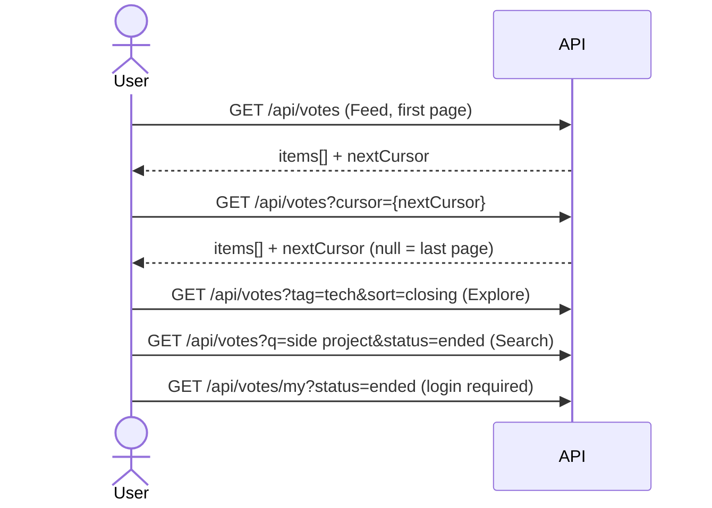

# Discovering Polls (Feed / Explore / Search / My Polls)

For field details see Swagger (`GET /api/votes`, `GET /api/votes/my`); for pagination rules see [conventions §3](../conventions.md).

## Scenario

Users see the latest Open Polls on the home page (Feed), browse by tag (Explore), search by keyword (Search), or view Polls they created / voted in.

## Sequence

## Call order

| Screen | API | Order | Notes |
|--------|-----|-------|-------|
| Feed | `GET /api/votes` | Open, most recently started first | Defaults to `status=open&sort=newest`; public |
| Explore (open) | `GET /api/votes?tag={slug}` | `sort=newest` (default) or `sort=closing` (ending soonest first) | `tag` is a tag slug from `GET /api/tags` |
| Explore (ended) | `GET /api/votes?tag={slug}&status=ended` | Most recently ended first | **Must not send `sort`**, otherwise 400 `vote.list.sort_not_allowed` |
| Search | `GET /api/votes?q={text}` | Same as Explore | Matches title and description, **not option text**; at least 2 characters; can be combined with `tag`, `status`, `sort` |
| My Polls (open) | `GET /api/votes/my` | Ending soonest first | Login required. Includes your own **Scheduled** and Open Polls, plus Open Polls where you hold a Ballot |
| My Polls (ended) | `GET /api/votes/my?status=ended` | Most recently ended first | Includes Cancelled; each item has `unread` (whether the Ended Notification is unread) |
| Polls on a user's public page | `GET /api/users/{username}/votes` | Most recently opened first | Public; lists only opened Polls created by that user (Open, Ended), excluding Scheduled ones and ones cancelled before opening. Does not support `status` / `sort` / `tag` / `q`. See [profile.md](profile.md) |

### Parameters

| Parameter | Applies to | Description |
|-----------|------------|-------------|
| `status` | Both | `open` (default) or `ended`; other values return 400 `common.invalid_status` |
| `sort` | Only `GET /api/votes` with `status=open` | `newest` (default) or `closing`; other values return 400 `common.invalid_sort` |
| `tag` | Only `GET /api/votes` | Tag slug; blank means no filter |
| `q` | Only `GET /api/votes` | Keyword (leading/trailing whitespace trimmed); blank means no search; fewer than 2 characters returns 400 `vote.search.query_too_short` |
| `cursor` | Both | The previous page's `nextCursor`, passed back unchanged; an arbitrary value returns 400 `common.cursor_invalid` |
| `limit` | Both | Default 20, clamped to 1–50, never errors |

### Cursor pagination

- Omit `cursor` for the first page; then send the previous page's `nextCursor`; `nextCursor = null` means there is no next page.
- Changing any filter (`status`, `sort`, `tag`, `q`) means dropping the old cursor and starting over. A cursor is bound to the sort key; mixing it across sorts gives garbled results or a 400.
- No page jumping and no total count.

## State and UI mapping

| List | Poll states that appear | Notes |
|------|-------------------------|-------|
| Feed / Explore / Search (`status=open`) | Open only | **Scheduled never appears** in public lists |
| Explore / Search (`status=ended`) | Ended (both naturally ended and Closed) | `options[].votes` has values |
| My Polls (`open`) | Scheduled + Open | Distinguish with `votingActive`; Scheduled has `votingActive=false` |
| My Polls (`ended`) | Ended + Cancelled | Show a red dot when `unread=true`; mark as read through the notification flow (`POST /api/notifications/{voteId}/read`) |

- List items are the same `VoteResponse` as `GET /api/votes/{voteId}`: for Open Polls `options[].votes` is always `null` (Sealed); only `participantCount` (Turnout) is available.
- When a public list request carries a token, each item's `myOptionId` shows which option you picked, so the "voted" state can be rendered directly.
- `unread` only has a value in "My Polls → `status=ended`"; otherwise it is `null`.

## Common errors

| errorCode | HTTP | When | Suggested UI |
|-----------|------|------|--------------|
| `common.invalid_status` | 400 | `status` is not `open` / `ended` | Development-time error; check parameters |
| `common.invalid_sort` | 400 | `sort` is not `newest` / `closing` | Same as above |
| `vote.list.sort_not_allowed` | 400 | `sort` sent with `status=ended` | Remove `sort` when switching to the ended tab |
| `vote.search.query_too_short` | 400 | `q` is shorter than 2 characters | Do not submit until at least 2 characters are typed |
| `common.cursor_invalid` | 400 | `cursor` was not issued by this endpoint | Drop the cursor and reload from the first page |
| `common.unauthorized` / `auth.token.expired` | 401 | `/api/votes/my` called while logged out or expired | See [conventions §2](../conventions.md) |
