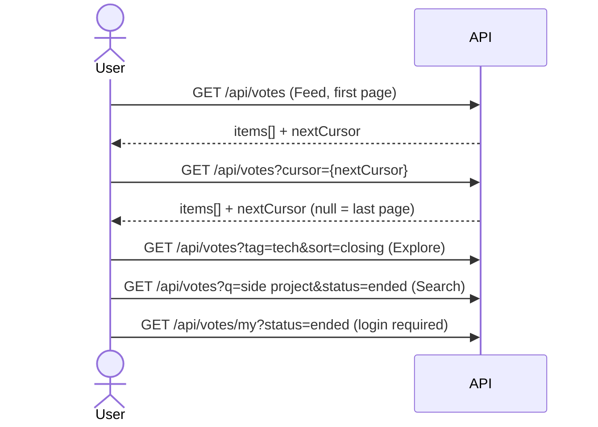

# Discovering Polls (Feed / Explore / Search / My Polls)

For field details see Swagger (`GET /api/votes`, `GET /api/votes/my`); for pagination rules see [conventions §3](../conventions.md).

## Scenario

Users see the latest Open Polls on the home page (Feed), browse by tag (Explore), search by keyword (Search), see the most-voted Open Polls (Top) or Polls by people they follow (Following), or view Polls they created / voted in / are invited to.

## Sequence

## Call order

| Screen | API | Order | Notes |
|--------|-----|-------|-------|
| Feed | `GET /api/votes` | Open, most recently started first | Defaults to `status=open&sort=newest`; public |
| Explore (open) | `GET /api/votes?tag={slug}` | `sort=newest` (default), `sort=closing` (ending soonest first) or `sort=top` (highest Turnout first, ties most recently opened first) | `tag` is a tag slug from `GET /api/tags` |
| Explore (ended) | `GET /api/votes?tag={slug}&status=ended` | Most recently ended first | **Must not send `sort`**, otherwise 400 `vote.list.sort_not_allowed` |
| Top | `GET /api/votes?sort=top` | Highest Turnout first | Turnout changes between pages, so dedupe items by `id`; combines with `tag` and `q` |
| Following | `GET /api/votes/following` | Open, most recently started first | Login required. Open Public Polls by users you follow or carrying a tag you follow (`PUT /api/tags/{tagId}/follow`; your tags: `GET /api/tags/following`), each once. Does not support `status` / `sort` / `tag` / `q` |
| Search | `GET /api/votes?q={text}` | Same as Explore | Matches title and description, **not option text**; at least 2 characters; can be combined with `tag`, `status`, `sort` |
| My Polls (open) | `GET /api/votes/my` | Ending soonest first | Login required. Includes your own **Scheduled** and Open Polls, Open Polls where you hold a Ballot, and Scheduled / Open Polls you are invited to, Unlisted and Invite-only included; each item has `unread` (whether your Invitation is unread; `false` otherwise) |
| My Polls (ended) | `GET /api/votes/my?status=ended` | Most recently ended first | Includes Cancelled; each item has `unread` (whether the Ended Notification is unread) |
| Bookmarked | `GET /api/votes/bookmarked` | Most recently bookmarked first | Login required. Any state and Audience; bookmark with `PUT` / `DELETE /api/votes/{voteId}/bookmark`. Every Poll response carries `bookmarked` for the signed-in caller. A Poll bookmarked before it Ends gives a `RESULT` notification when it Ends; Polls whose owner blocked you are left out, and `DELETE` always succeeds |
| Polls on a user's public page | `GET /api/users/{username}/votes` | Most recently opened first | Public; lists only opened Public Polls created by that user (Open, Ended), excluding Scheduled ones and ones cancelled before opening. Does not support `status` / `sort` / `tag` / `q`. See [profile.md](profile.md) |

### Parameters

| Parameter | Applies to | Description |
|-----------|------------|-------------|
| `status` | `GET /api/votes`, `/my` | `open` (default) or `ended`; other values return 400 `common.invalid_status` |
| `sort` | Only `GET /api/votes` with `status=open` | `newest` (default), `closing` or `top`; other values return 400 `common.invalid_sort` |
| `tag` | Only `GET /api/votes` | Tag slug; blank means no filter |
| `q` | Only `GET /api/votes` | Keyword (leading/trailing whitespace trimmed); blank means no search; fewer than 2 characters returns 400 `vote.search.query_too_short` |
| `cursor` | All lists | The previous page's `nextCursor`, passed back unchanged; an arbitrary value returns 400 `common.cursor_invalid` |
| `limit` | All lists | Default 20, clamped to 1–50, never errors |

### Cursor pagination

- Omit `cursor` for the first page; then send the previous page's `nextCursor`; `nextCursor = null` means there is no next page.
- Changing any filter (`status`, `sort`, `tag`, `q`) means dropping the old cursor and starting over. A cursor is accepted only by the list and ordering that issued it; sending it to another (e.g. `sort=newest` to `sort=closing`, My Polls `open` to `ended`) returns 400 `common.cursor_invalid`.
- No page jumping and no total count.

## State and UI mapping

| List | Poll states that appear | Notes |
|------|-------------------------|-------|
| Feed / Explore / Search / Top (`status=open`), Following | Open only | **Scheduled never appears** in public lists; nor do Unlisted and Invite-only Polls |
| Explore / Search (`status=ended`) | Ended (both naturally ended and Closed) | `options[].votes` has values |
| My Polls (`open`) | Scheduled + Open | Distinguish with `votingActive`; Scheduled has `votingActive=false`. Show a red dot when `unread=true` (unread Invitation) |
| My Polls (`ended`) | Ended + Cancelled | Show a red dot when `unread=true`; mark as read through the [notification flow](notifications.md) |

- List items are the same `VoteResponse` as `GET /api/votes/{voteId}`: for Open Polls `options[].votes` is always `null` (Sealed); only `participantCount` (Turnout) is available.
- When a public list request carries a token, each item's `myOptionId` shows which option you picked, so the "voted" state can be rendered directly, and Polls created by users the caller blocked, or by users who blocked the caller, are left out. A user who blocked you also disappears from your `following` list and My Polls, and their profile Poll list is empty for you (`totalPolls` still counts them).
- `unread` only has a value in My Polls (both tabs); otherwise it is `null`.

## Common errors

| errorCode | HTTP | When | Suggested UI |
|-----------|------|------|--------------|
| `common.invalid_status` | 400 | `status` is not `open` / `ended` | Development-time error; check parameters |
| `common.invalid_sort` | 400 | `sort` is not `newest` / `closing` / `top` | Same as above |
| `vote.list.sort_not_allowed` | 400 | `sort` sent with `status=ended` | Remove `sort` when switching to the ended tab |
| `vote.search.query_too_short` | 400 | `q` is shorter than 2 characters | Do not submit until at least 2 characters are typed |
| `common.cursor_invalid` | 400 | `cursor` was not issued by this list and ordering | Drop the cursor and reload from the first page |
| `common.unauthorized` / `auth.token.expired` | 401 | `/api/votes/my` or `/api/votes/following` called while logged out or expired | See [conventions §2](../conventions.md) |
