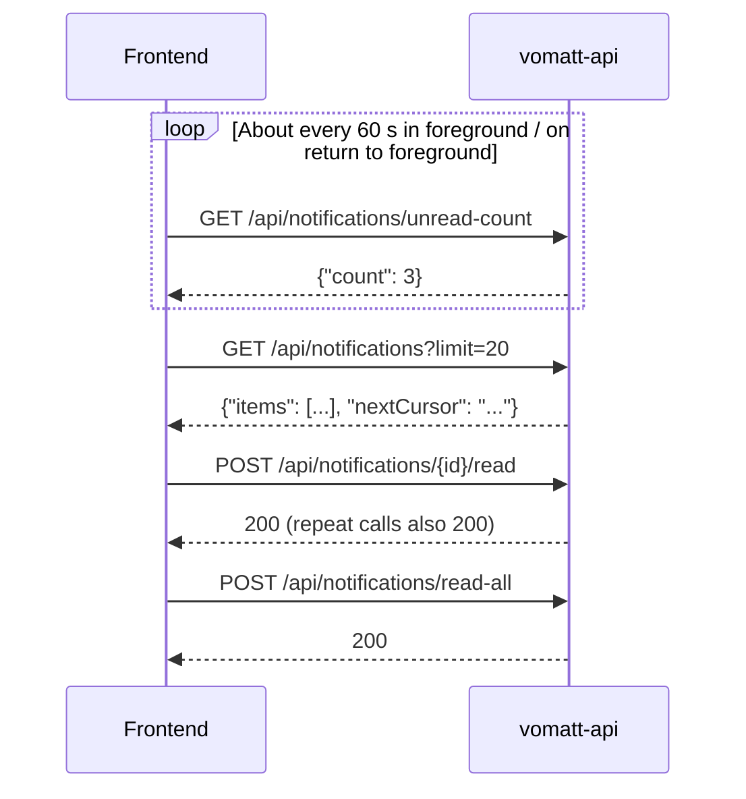

# Notifications

## Scenario
The user opens the notifications page to see what happened: Polls that Ended, Invitations, new followers, Comments on their Polls and replies to their Comments, and (if switched on) Polls about to close that they have not voted in. The nav bar shows an unread badge. See Swagger (tag `Notification`) for field details.

## Sequence

## Call order
| Step | API | Notes |
|------|-----|-------|
| 1 | `GET /api/notifications/unread-count` | Red dot / badge count, at most 100 ("99+") |
| 2 | `GET /api/notifications` | The feed, newest first; pass `nextCursor` back as `cursor` for more |
| 3 | `POST /api/notifications/{id}/read` | When the user opens an item; idempotent. `id` is the item's `id` |
| 4 | `POST /api/notifications/read-all` | "Mark all read" |
| - | `GET` / `PATCH /api/users/me/notification-preferences` | Settings page switches |

## Kinds and UI mapping
Notifications are **not stored**; they are derived from Polls, Invitations, follows and Comments when read (ADR 0003, ADR 0005). Only read state is stored.

| `kind` | When | `actor` | `poll` | `comment` | Switch |
|--------|------|---------|--------|-----------|--------|
| `RESULT` | A Poll you own, hold a Ballot in or are an Invitee of has Ended (Deadline passed, Closed, or every Invitee voted). Not after a Retraction unless you are an Invitee | null | yes | null | `resultsIn` |
| `CANCELLED` | An Invite-only Poll you are invited to was Cancelled before it opened (only Polls Cancelled before 2026-10-14) | owner | yes | null | `resultsIn` |
| `INVITATION` | You are an Invitee of a Scheduled or Open Invite-only Poll. Replaced by `RESULT` once the Poll Ends. Removed and invited again: a new, unread one | owner | yes | null | `invitations` |
| `FOLLOWED` | Someone followed you. One item per follower: group them ("@bkim and 3 others followed you") | follower | null | null | none |
| `COMMENT` | Someone else commented on or replied under your Poll, or replied to your Comment | author | yes | `{ id, excerpt }` | `comments` |
| `CLOSING_SOON` | An Open Poll ends within 24 hours, you hold no Ballot, and you are its Invitee or it is a Public Poll of someone you follow. Gone once you vote or it Ends | owner | yes | null | `closingSoon` (off by default) |

- `createdAt` is when it happened: the Poll's end, the Invitation, the follow, the Comment, or 24 hours before the Poll's end for `CLOSING_SOON` (its start if later). Group by day with it.
- `poll` is `{ id, title, endTime, status, turnout }`. It never carries per-option counts, so a Sealed Poll shows only Turnout ("342 voted so far"). Link to `/poll/{poll.id}`; for `RESULT`, the results page.
- Nothing from a suspended user, a user you blocked or a user who blocked you is listed or counted.
- An item can vanish (Comment deleted, follow undone, Poll Deleted, block) or appear behind the cursor (you follow someone); de-duplicate by `id`.

## Read state
- `read` is per item. `POST /api/notifications/{id}/read` reads one; `POST /api/notifications/read-all` reads everything whose `createdAt` is at or before now, switched-off kinds included. Later items arrive unread.
- **Unread count** = feed items with `read` false, of the kinds switched on. It updates on the next call; no event is needed (a Poll Ending raises it by itself).
- **No push or email**: the frontend must poll. Recommended: check once after login and whenever the app / tab returns to the foreground, every 60 seconds while in the foreground, and pause in background tabs. Poll only `unread-count`; fetch the feed when the user opens the page.
- Deprecated: `POST /api/notifications/{voteId}/read` with a Poll id reads that Poll's Invitation while it is not Ended, its `RESULT` after. `GET /api/votes/my` items still carry `unread` for the same two. Both keep working until the web moves to the feed.

## Common errors
| errorCode | When | Suggested UI |
|-----------|------|--------------|
| `notification.not_found` | The id is unknown or malformed, or the item is gone (see above) | Ignore and refresh the list |
| `vote.not_found` | Deprecated Poll id only: the Poll does not exist or is Deleted | Ignore and refresh the list |
| `common.cursor_invalid` | `cursor` came from another list | Reload the first page |
| `auth.token.expired` / `auth.token.invalid` / `common.unauthorized` | See [conventions](../conventions.md) | Refresh or redirect to login per convention |
