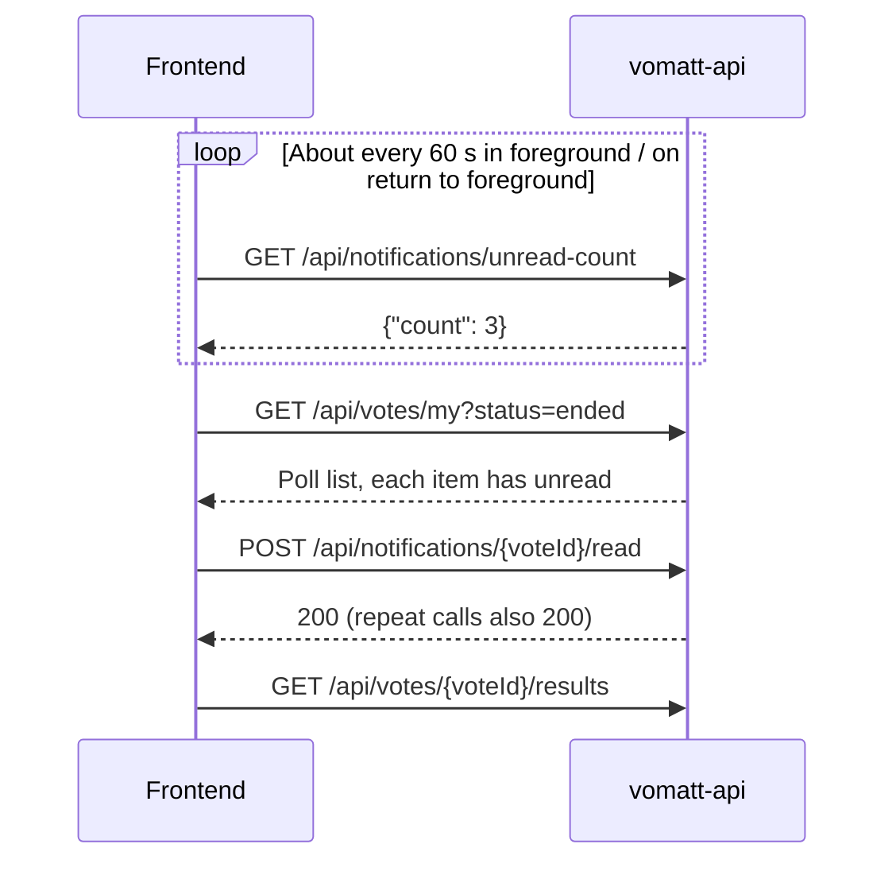

# Notifications (Ended Notification)

## Scenario
After a Poll ends, the owner and Participants should be reminded to "go see the results". The frontend shows an unread red dot in the nav bar, and the user marks items as read one by one after opening the list. See Swagger (tag `Notification`) for field details.

## Sequence

## Call order
| Step | API | Notes |
|------|-----|-------|
| 1 | `GET /api/notifications/unread-count` | Red dot / badge count |
| 2 | `GET /api/votes/my?status=ended` | **The notification list itself**. Each item's `VoteResponse.unread` indicates unread; there is no separate `GET /api/notifications` |
| 3 | `POST /api/notifications/{voteId}/read` | Call when the user opens that Poll; idempotent |
| 4 | `GET /api/votes/{voteId}/results` | Notification leads to the results page |

## State and UI mapping
Notifications are **not stored in the database**; they are derived from Poll state at read time (ADR 0003), and only "read" records are stored.

| Case | Notification generated? |
|------|-------------------------|
| Poll is Ended (expired or Closed early by the owner) and you are the owner | Yes |
| Poll is Ended and you hold a Ballot (Participant) | Yes |
| Participant made a Retraction before it ended | No |
| Closed while Scheduled (Cancelled) | No (`unread` is always `false`) |
| Poll not yet Ended | No |

- **Unread count** = number of Polls matching the conditions above that you have not called `read` on. The count increases by 1 automatically the moment a Poll expires; no event is needed.
- **No push**: the frontend must poll. Recommended: check once after login and whenever the app / tab returns to the foreground, every 60 seconds while in the foreground, and pause in background tabs. Poll only `unread-count`, not the list; fetch the list when the user opens the notifications page.
- After marking as read, `unread-count` drops by 1 immediately and that item's `unread` becomes `false`; marking again does not decrement further.
- `unread` only has a value in `status=ended` lists; with `status=open` (default) it is `null`.

## Common errors
| errorCode | When | Suggested UI |
|-----------|------|--------------|
| `notification.not_found` | The Poll is not yet Ended, is Cancelled, does not exist, or you are neither owner nor Participant | Ignore and refresh the list |
| `common.bad_request` | `voteId` is not a valid id | Generic error message |
| `auth.token.expired` / `auth.token.invalid` / `common.unauthorized` | See [conventions](../conventions.md) | Refresh or redirect to login per convention |
