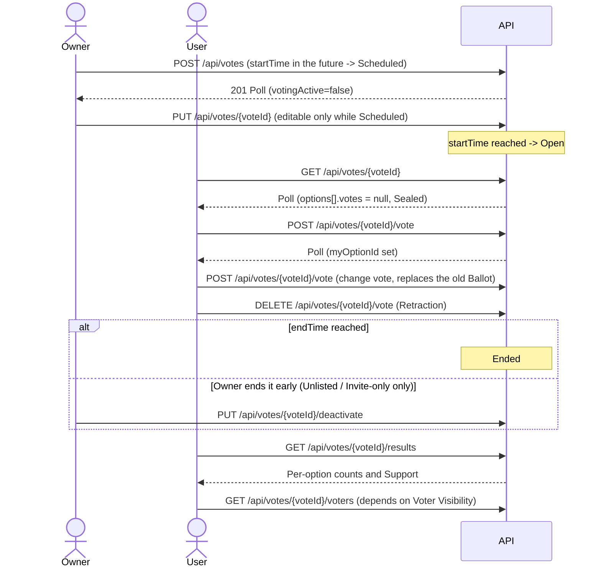

# Poll Lifecycle

For field details see Swagger (tag `Vote`); for terms see the [glossary](../glossary.md), and for the error format see [conventions](../conventions.md).

## Scenario

The owner creates a Poll and (optionally) schedules it. Once Open, users cast / change / retract a Ballot, and after it ends everyone can see the results.

## Sequence

## Call order

| Step | API | Notes |
|------|-----|------|
| 1. Create | `POST /api/votes` | Returns **201**. No `startTime` (or a past time) -> Open immediately; a future time -> Scheduled. `endTime` is required, at most 365 days after the start; 2-10 options (both limits are admin-configurable, the error message states the value in effect); `voterVisibility` defaults to `OWNER` and `audience` to `PUBLIC`, and neither can be changed once Open |
| 2. Edit (optional) | `PUT /api/votes/{voteId}` | Owner only, Scheduled only; same body as create (send the whole thing again). **Options are rebuilt as a batch, so option IDs change**; omitting `startTime`, `voterVisibility`, `audience`, `inviteeIds` or `inviteeEmails` keeps the current value |
| 3. Delete (optional) | `DELETE /api/votes/{voteId}` | Owner only; while Scheduled, or within the delete window after posting (default 20 minutes, admin-configurable) even with Ballots. Show the entry only when the Poll's `deletable` is `true` (set for the owner, `null` for everyone else). Afterwards every endpoint returns 404 `vote.not_found`, owner included; nobody is notified. A Scheduled Poll cannot be Closed (400 `vote.close.scheduled`); Delete it instead |
| 4. View | `GET /api/votes/{voteId}` | Public; includes `myOptionId` when signed in. Readable in Scheduled / Open / Ended |
| 5. Check whether I voted | `GET /api/votes/{voteId}/my-vote-status` | Or just read the Poll's `myOptionId` (saves a call) |
| 6. Vote / change vote | `POST /api/votes/{voteId}/vote` | Body `{"optionIds":["..."], "anonymous": true}`, **exactly one ID**; `anonymous` is optional (see [Anonymous Ballots](#anonymous-ballots)). Replaces an existing Ballot; choosing the same option only updates `anonymous` (counts and Turnout unchanged). Open only |
| 7. Retract | `DELETE /api/votes/{voteId}/vote` | Retracts the whole Ballot; idempotent (returns 200 even with no Ballot). Open only. `DELETE .../vote/{optionId}` is kept for backward compatibility; use the former |
| 8. End early (optional) | `PUT /api/votes/{voteId}/deactivate` | Owner only, Unlisted and Invite-only Polls only: a Public Poll runs to its `deadline` (400 `vote.close.public_not_allowed`). Open -> Ended immediately (`endTime` moves, `deadline` stays); no change if already Ended. The response is only a `SimpleResultResponse`, so `GET` the Poll again for the new state |
| 9. View results | `GET /api/votes/{voteId}/results` | Public, Ended only; before that returns 403 `vote.results.sealed`. `percentage` is Support (0-100, not rounded) |
| 10. See who voted for what | `GET /api/votes/{voteId}/voters?cursor=&limit=` | Requires sign-in and an Ended Poll, then decided by Voter Visibility; cursor pagination, oldest Ballot first |
| 11. Report (optional) | `POST /api/votes/{voteId}/report` | Login required. Body `{ reason, note? }`, `reason` one of `SPAM`, `HARASSMENT`, `HATE`, `MISINFORMATION`, `OTHER`, `note` up to 500 characters. Any state. Idempotent: a repeat keeps the first report. Not on your own Polls (hide the action there). The owner is not told and the Poll stays until a moderator acts. 404 `vote.not_found` when the Poll is unreachable, including when its owner blocked you |

## Status and UI mapping

A Poll has no `status` field; the status is derived from times and `votingActive`:

| Status | Condition | Allowed actions | Hidden / null fields |
|------|------|-----------|-------------------------|
| **Scheduled** | `now < startTime` | Owner: edit, Delete. Others: can only view; no actions besides commenting | `options[].votes = null`; `votingActive=false`; voting not possible |
| **Open** | `votingActive=true` | Vote, change vote, retract; owner can Close an Unlisted / Invite-only Poll, and Delete within the delete window | `options[].votes = null` (**Sealed**, not even the owner can see them); `/results` and `/voters` return 403. **Only `participantCount` (Turnout) is visible** |
| **Ended** | `now >= endTime` (natural end or Closed; `endTime < deadline` means it ended early) | View `/results`, `/voters` (depending on Voter Visibility); Ballots are frozen | `options[].votes` has values |
| **Cancelled** | Legacy: a kind of Ended, with `endTime <= startTime`; no longer produced | None; never accepted a Ballot, no Ended Notification | Same as Ended, but with no Ballots |

- `active=false` only means "the owner Closed it early"; on a natural end `active` is still `true`. Use `startTime` / `endTime` / `votingActive` to determine status, not `active`.
- `myOptionId`: `null` when not signed in, when there is no Ballot, for a just-created Poll (the create response), or once your Anonymous Ballot of an Ended Poll was sealed (within a day of the end).
- `myBallotAnonymous`: whether your Ballot is Anonymous; `null` when you hold no Ballot. A sealed Anonymous Ballot has `myOptionId` `null` but `myBallotAnonymous` `true`, so show "you took part" without an option.
- `unread`: only has a value in My Polls (both `status` tabs); it is `null` on every other endpoint (see [discovery](discovery.md)).
- `shareCount`: distinct signed-in users who shared the Poll, always present (see [Sharing](#sharing)).
- When the Scheduled or Open countdown ends on the frontend, re-`GET /api/votes/{voteId}` instead of assuming the status has switched.

### Voter Visibility (who can see `/voters`)

| `voterVisibility` | Owner | Other signed-in users | Not signed in |
|-------------------|--------|-----------|--------|
| `NOBODY` | 403 `vote.voters.hidden` | 403 `vote.voters.hidden` | 401 |
| `OWNER` (default) | Allowed | 403 `vote.voters.hidden` | 401 |
| `SIGNED_IN` | Allowed | Allowed | 401 |

`SIGNED_IN` means anyone who can see the Poll: on an Invite-only Poll, only the owner and Invitees (everyone else gets 404 `vote.not_found`). Before the Poll is Ended, every level returns 403 `vote.results.sealed`. Participants can see this level from the Poll's `voterVisibility` before voting; show it to the user before they vote.

### Anonymous Ballots

- An Anonymous Ballot is never listed in `/voters`, at any Voter Visibility level, so the list can be shorter than `participantCount`. Turnout, the Invitee list's `hasBallot` and your own `myOptionId` (until sealed after the Poll Ends) still count it.
- While an Ended Poll holds any Anonymous Ballot other than the caller's own, `/voters` still lists who took part but `optionId` is `null` for every item (otherwise the anonymous choices could be worked out from the named ones and the totals). Render the list without choices in that case.
- `anonymous` omitted or `null` keeps the flag of your current Ballot (also when changing option); a first Ballot, or one cast after a Retraction, uses the account default `anonymousBallotByDefault` (see [profile](profile.md)). Send `anonymous` explicitly when the user toggles it.

### Ballot replacement and Retraction

- Changing a vote is just another `POST .../vote`; the server replaces the old Ballot in the same transaction, and Turnout does not increase. The `votedAt` in the response (see `/voters`) is the time of the current Ballot.
- After a Retraction the user is no longer a Participant, Turnout goes down by 1, and they will not receive the Ended Notification (an Invitee of an Invite-only Poll still does).
- After a Poll is Ended, Ballots are frozen: voting, changing, and retracting all return 400 `vote.ended`.
- An Open Invite-only Poll Ends as soon as every Invitee holds a Ballot (the owner's own never counts; a Poll with no Invitees never auto-ends). The Ballot that completes it gets back an Ended, unsealed Poll, so read the status from `endTime` on the `POST .../vote` response too.

### Sharing

After the user shares the Poll's link with the share button, call `POST /api/votes/{voteId}/share` with `{"channel": "COPY_LINK"}` (or `NATIVE` for `navigator.share`, `LINE`, `FACEBOOK`, `X`, `THREADS`, `OTHER`); it returns the new `shareCount`. Sign-in required, any Poll state the caller can reach. Idempotent per user and Poll: a repeat keeps the first `channel` and leaves the count unchanged. For a signed-out viewer, share the link but skip the call (it would be 401).

### Opening an Invitation link

`GET /api/votes/{voteId}` returns 404 `vote.not_found` for an Invite-only Poll to anyone but its owner and Invitees, including a signed-out user and a signed-in user not yet tied to their Invitee row. To show "<username> invited you" on that page, call `GET /api/votes/{voteId}/creator` (public, login ignored): it returns only the owner's `username` and `avatarUrl`. It returns 404 `vote.not_found` for an unknown, Deleted, Public or Unlisted Poll, so a 404 there means the link is not a live Invitation. On 200:

- Signed out: prompt sign-in.
- Signed in but `GET /api/votes/{voteId}` still returns 404: this account is not the invited one. An Invitation sent to an email address is tied to the account that verifies that address, so suggest signing in with, or verifying, the invited email.

## Common errors

| errorCode | HTTP | When it happens | Suggested UI |
|-----------|------|---------|---------|
| `vote.not_found` | 404 | Poll does not exist, is Deleted, is Invite-only and the caller is neither its owner nor an Invitee, or its owner blocked the caller (an Invitee too: the block wins) | Show not found |
| `vote.not_allowed` | 400 | Voting on / retracting from a Scheduled Poll | Disable the button and show the start time |
| `vote.ended` | 400 | Voting on / changing / retracting on an Ended Poll | Reload the Poll and switch to the results view |
| `vote.option.not_found` | 404 | Option ID does not exist (e.g. IDs changed after editing a Scheduled Poll) | Reload the Poll |
| `vote.option.not_in_vote` | 400 | The option belongs to another Poll | Reload the Poll |
| `vote.multiple.not_allowed` | 400 | More than one `optionIds`, or `allowMultipleChoices=true` at creation | Enforce single choice on the frontend |
| `vote.not_editable` | 400 | The Poll being edited is already Open or Ended | Hide the edit entry |
| `vote.forbidden` | 403 | A non-owner edits / Closes / Deletes | Hide the edit / Close / Delete entry |
| `vote.close.public_not_allowed` | 400 | Close on an Open Public Poll | Hide the Close entry for Public Polls |
| `vote.close.scheduled` | 400 | Close on a Scheduled Poll | Offer Delete instead |
| `vote.delete.window_passed` | 400 | Delete on an Open or Ended Poll after the delete window | Hide the Delete entry when `deletable` is `false` |
| `vote.results.sealed` | 403 | `/results` or `/voters` requested before the Poll is Ended | Show only Turnout |
| `vote.voters.hidden` | 403 | Voter Visibility does not allow the current user | Do not show the voter list |
| `common.conflict` | 409 | The Poll stayed busy with other changes for 3 seconds (vote, retract, edit, Close, delete, Invitee changes); nothing was recorded | Retry the request |
| `common.rate_limited` | 429 | More than 30 Ballot writes by this account within 60 seconds (no `Retry-After`), or the per-IP limit | Disable the vote button and retry after about a minute |
| `vote.options.min` / `vote.options.max` | 400 | Fewer than 2 options, or more than the limit (default 10) | Form hint (the message states the limit) |
| `vote.end_time.past` | 400 | `endTime` is in the past | Form hint |
| `vote.end_time.before_start` | 400 | `endTime` is not later than `startTime` | Form hint |
| `vote.duration.exceeded` | 400 | Start to end exceeds the limit (default 365 days) | Form hint (the message states the limit) |
| `vote.invitee.not_invite_only` / `vote.invitee.ids_invalid` | 400 | Invitees sent for a Poll that is not Invite-only / an unknown or suspended `inviteeIds` user | Form hint |
| `vote.report.self` | 400 | Reporting your own Poll | Hide the report action on your own Polls |
| `tag.ids.invalid` | 400 | `tagIds` contains a nonexistent tag | Reload the tag list |
| `common.validation_failed` | 400 | Field length / required, including each option's `text` (only the first field error is returned) | Highlight that field |
