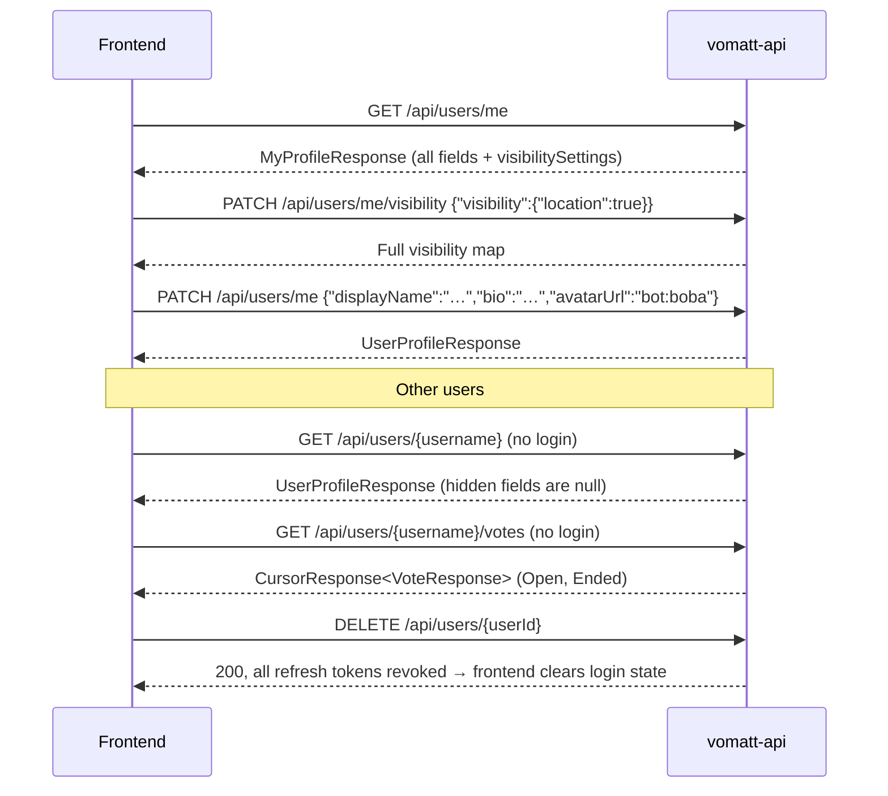

# Profile and Public Page

## Scenario
Users view / edit their own profile and choose which fields are public; others view the public page by username, see Polls that user created, or search users. Users follow and block each other, export their data, and can delete their own account. See Swagger (tag `User`) for field details.

## Sequence

## Call order
| Step | API | Notes |
|------|-----|-------|
| 1 | `GET /api/users/me` | Your own profile; **not affected by visibility**, all fields returned. `visibilitySettings` is "what others see" |
| 2 | `PATCH /api/users/me/visibility` | Send only the fields to change; unsent fields stay as-is, unknown keys are ignored; returns the full settings |
| 3 | `PATCH /api/users/me` | Changes `username` / `displayName` / `firstName` / `lastName` / `birthday` / `bio` / `avatarUrl` / `anonymousBallotByDefault`; omitted or `null` = unchanged (send an empty string to clear `displayName` / `bio` / `firstName` / `lastName`; `avatarUrl` and `birthday` cannot be cleared). Omit `username` when it is unchanged. Returns `UserProfileResponse` with the fields you explicitly hid set to `null` (fields whose visibility you never set are shown); `mutualFollowers*` are `null` |
| 4 | `GET /api/users/{username}` | Public, no login. Profile fields are the same whoever asks; only the viewer fields differ: `isFollowing` / `isBlocked` / `followsYou` are `null` when signed out (an invalid token counts as signed out, not 401) and `false` on your own profile, `mutualFollowersCount` / `mutualFollowersPreview` are `null` when signed out and on your own profile |
| 4a | `GET /api/users/{username}/votes` | Public, no login; **opened** Polls created by that user (Open, Ended), most recently opened first, cursor-paginated. Excludes Scheduled ones and ones cancelled before opening. When logged in, includes your own voting state on each Poll |
| 5 | `GET /api/users/search?username=` | Login required; partial, case-insensitive match, ordered by username, cursor-paginated (see [conventions](../conventions.md)); suspended users are not listed |
| 6 | `DELETE /api/users/{userId}` | Self, or an active admin signed in through the admin console; on success all refresh tokens of that account become invalid |

## State and UI mapping
Fields controlled by visibility settings: `firstName`, `lastName`, `location`, `points`, `membershipLevel` (**hidden** by default), and `displayName`, `bio` (**public** by default). `email` and `birthday` are never on the public page; only `GET /api/users/me` returns them.

| Field (public page `UserProfileResponse`) | When `null` | UI |
|------|------|-----|
| `firstName`, `lastName`, `location`, `points`, `membershipLevel` | Owner has not made it public (default), or it has no value | Hide the whole row; do not infer anything beyond "hidden" |
| `displayName`, `bio` | Owner turned off public visibility, or the user never set it (public by default) | When `displayName` is `null`, use `username` as the display name |
| `id`, `username`, `avatarUrl`, `joinedAt`, `totalPolls`, `totalVotes`, `followersCount`, `followingCount` | Always present (`avatarUrl` is `null` when never set) | — |

Notes:
- Suspended users (`active=false`) do not exist publicly: both the public page and Poll list return 404 `user.not_found`, and search does not list them.
- `totalPolls` only counts **opened** Polls (Open, Ended), matching the count of `GET /api/users/{username}/votes`. `totalPolls` in `GET /api/users/me` is computed the same way.
- `UserDto` from `GET /api/users/search` carries only public fields: `id`, `username`, `displayName` (`null` when the owner hid it) and `avatarUrl`.
- **Username**: 3-50 characters of `[a-z0-9_]`, and not a reserved name (`search`, `account`, `explore`, `login`, `notifications`, `poll`, `sanity`, `api`, `me`, `my`, `admin`, `settings`), since profiles live at `/{username}` on the web. After a change the old public path returns 404. An older account that already holds a reserved name keeps it, but gets 400 if it sends it back, so omit `username` when unchanged.
- **Avatar** (`avatarUrl`): one of the bot cast, stored as `bot:<kind>` (48 kinds, same list as vomatt-web `src/features/avatars/catalog.ts`). New accounts get a random one; `PATCH` accepts only a known `bot:<kind>` or `bot:none` (the user chose no character: draw a plain account icon). Always public. Older accounts may still hold a Google / LINE image URL or `null`; fall back to the username default. Every response that names another user carries their avatar too: `creatorAvatarUrl` (Poll, results), `authorAvatarUrl` (comments), `avatarUrl` (voters, Invitees, Invite List members; `null` for email entries).
- `totalVotes` is "the number of Public Polls (not Deleted) where you hold a Ballot", not the number of votes cast; Ballots on Unlisted and Invite-only Polls are left out, matching `totalPolls`.
- `anonymousBallotByDefault` (only in `GET /api/users/me`, `false` until set): whether a first Ballot is Anonymous when the vote request omits `anonymous` (see [poll lifecycle](poll-lifecycle.md#anonymous-ballots)). Changing it does not touch Ballots already cast.
- Account deletion is irreversible; on success the frontend should clear local tokens and return to the login page.
- `GET /api/users/me/export` (login required) returns everything stored about the caller as one JSON document, once per UTC day; a second call that day is 429 `common.rate_limited`.

## Follow and block
| API | Notes |
|-----|-------|
| `POST` / `DELETE /api/users/me/follows/{userId}` | Follow / unfollow (one-way); both idempotent. The followed user gets a `FOLLOWED` [notification](notifications.md), gone again on unfollow |
| `POST` / `DELETE /api/users/me/blocks/{userId}` | Block / unblock; both idempotent. Blocking also unfollows them; the blocked user is not told |
| `GET /api/users/me/follows`, `GET /api/users/me/blocks` | Whom you follow / blocked, most recently first |
| `GET /api/users/{username}/followers`, `/following` | Who follows the user / whom the user follows, most recently followed first |
| `GET /api/users/{username}/mutual-followers` | The user's followers whom you follow ("Followed by @jtan and 2 others you follow"); empty on your own profile |

- All lists require login and are cursor-paginated; a cursor works only on the list (and user) it came from, otherwise 400 `common.cursor_invalid`. Suspended users are left out of every list and are 404 `user.not_found` as a target; an existing follow or block shows again once they are unsuspended.
- Follow list items carry `isFollowing` / `followsYou` (`false` on your own entry), so rows can offer "Follow back" without fetching the profile. `isFollowing` and `isBlocked` on a profile are never both `true`.
- A block works both ways for Polls: you no longer see the blocked user's Polls in `GET /api/votes` (Feed / Explore / Search / Top), and every Poll you created becomes 404 `vote.not_found` for them, gone from all their lists, My Polls and notifications (`GET /api/votes/{voteId}/creator` still names you). Their Comment threads and Replies are hidden from you only ([comments](comments.md)). Notifications and mutual followers drop users with a block in either direction. Nothing is deleted: their earlier Ballots still count, and unblocking restores everything. Followers / following lists and their counts, profiles and `totalPolls` are not filtered.

## Common errors
| errorCode | When | Suggested UI |
|-----------|------|--------------|
| `user.not_found` | username / userId does not exist, the user is suspended (public page, Poll list, follow lists, follow / block target), or your own account no longer exists | Show user not found; for `/me`, treat as logged out |
| `user.delete.forbidden` | Deleting another user's account without admin | Show no permission (do not log out) |
| `common.missing_param` | Search `username` is missing or blank | Do not send the request when the search box is empty |
| `common.cursor_invalid` | The Poll list `cursor` was not issued by this API | Reload from the first page |
| `common.validation_failed` | `username` not 3-50 of `[a-z0-9_]` or reserved, `displayName` over 100 characters, `firstName` / `lastName` over 50 characters, `birthday` before 1900-01-01 or not before today (Asia/Taipei), `bio` over 500 characters, `avatarUrl` not a known `bot:<kind>` or `bot:none`, or `visibility` missing | Show the rule next to the field |
| `user.follow.self` / `user.block.self` | Following / blocking yourself | Hide the follow / block buttons on your own profile |
| `user.follow.blocked` | Following a user you blocked | Offer unblock first |
| `common.rate_limited` | Export already produced today (429) | Say it can be downloaded again tomorrow |
| `user.username.taken` | Another account already uses `username` | Ask for another username |
| `common.conflict` | Another account took `username` at the same moment (409) | Ask for another username |
| `common.bad_request` | `birthday` is not a valid `yyyy-MM-dd` date, or `userId` is not a valid id | Generic error message |
| `auth.token.expired` / `auth.token.invalid` / `common.unauthorized` | See [conventions](../conventions.md) | Refresh or redirect to login per convention |
