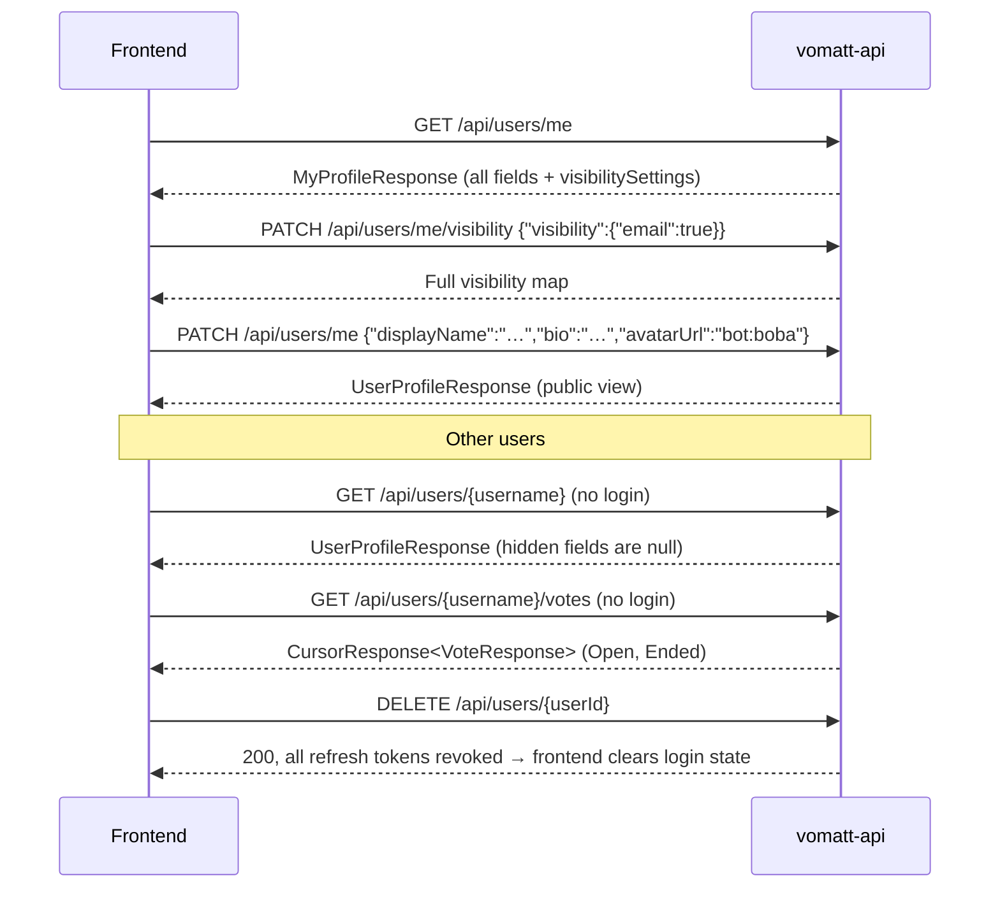

# Profile and Public Page

## Scenario
Users view / edit their own profile and choose which fields are public; others view the public page by username, see Polls that user created, or search users. Users can also delete their own account. See Swagger (tag `User`) for field details.

## Sequence

## Call order
| Step | API | Notes |
|------|-----|-------|
| 1 | `GET /api/users/me` | Your own profile; **not affected by visibility**, all fields returned. `visibilitySettings` is "what others see" |
| 2 | `PATCH /api/users/me/visibility` | Send only the fields to change; unsent fields stay as-is, unknown keys are ignored; returns the full settings |
| 3 | `PATCH /api/users/me` | Changes `username` / `displayName` / `bio` / `avatarUrl`; omitted or `null` = unchanged (send an empty string to clear `displayName` / `bio`; `avatarUrl` cannot be cleared). Omit `username` when it is unchanged. Returns the public view |
| 4 | `GET /api/users/{username}` | Public, no login; same response whether logged in or not |
| 4a | `GET /api/users/{username}/votes` | Public, no login; **opened** Polls created by that user (Open, Ended), most recently opened first, cursor-paginated. Excludes Scheduled ones and ones cancelled before opening. When logged in, includes your own voting state on each Poll |
| 5 | `GET /api/users/search?username=` | Login required; partial, case-insensitive match, ordered by username, cursor-paginated (see [conventions](../conventions.md)); suspended users are not listed |
| 6 | `DELETE /api/users/{userId}` | Self or admin; on success all refresh tokens of that account become invalid |

## State and UI mapping
Fields controlled by visibility settings: `email`, `firstName`, `lastName`, `location`, `points`, `membershipLevel` (**hidden** by default), and `displayName`, `bio` (**public** by default).

| Field (public page `UserProfileResponse`) | When `null` | UI |
|------|------|-----|
| `email`, `firstName`, `lastName`, `location`, `points`, `membershipLevel` | Owner has not made it public (default), or it has no value | Hide the whole row; do not infer anything beyond "hidden" |
| `displayName`, `bio` | Owner turned off public visibility, or the user never set it (public by default) | When `displayName` is `null`, use `username` as the display name |
| `username`, `avatarUrl`, `joinedAt`, `totalPolls`, `totalVotes` | Always present (`avatarUrl` is `null` when never set) | — |

Notes:
- Suspended users (`active=false`) do not exist publicly: both the public page and Poll list return 404 `user.not_found`, and search does not list them.
- `totalPolls` only counts **opened** Polls (Open, Ended), matching the count of `GET /api/users/{username}/votes`. `totalPolls` in `GET /api/users/me` is computed the same way.
- `UserDto` from `GET /api/users/search` carries only public fields: `id`, `username`, `displayName` (`null` when the owner hid it) and `avatarUrl`.
- **Username**: 3-50 characters of `[a-z0-9_]`, and not a reserved name (`search`, `account`, `explore`, `login`, `notifications`, `poll`, `sanity`, `api`, `me`, `my`, `admin`, `settings`), since profiles live at `/{username}` on the web. After a change the old public path returns 404. An older account that already holds a reserved name keeps it, but gets 400 if it sends it back, so omit `username` when unchanged.
- **Avatar** (`avatarUrl`): one of the bot cast, stored as `bot:<kind>` (48 kinds, same list as vomatt-web `src/features/avatars/catalog.ts`). New accounts get a random one; `PATCH` accepts only a known `bot:<kind>`. Always public. Older accounts may still hold a Google / LINE image URL or `null`; fall back to the username default. Every response that names another user carries their avatar too: `creatorAvatarUrl` (Poll, results), `authorAvatarUrl` (comments), `avatarUrl` (voters, Invitees, Group members; `null` for email entries).
- `totalVotes` is "the number of Polls where you hold a Ballot", not the number of votes cast.
- Account deletion is irreversible; on success the frontend should clear local tokens and return to the login page.

## Common errors
| errorCode | When | Suggested UI |
|-----------|------|--------------|
| `user.not_found` | username / userId does not exist, the user is suspended (public page, Poll list), or your own account no longer exists | Show user not found; for `/me`, treat as logged out |
| `user.delete.forbidden` | Deleting another user's account without admin | Show no permission (do not log out) |
| `common.missing_param` | Search `username` is missing or blank | Do not send the request when the search box is empty |
| `common.cursor_invalid` | The Poll list `cursor` was not issued by this API | Reload from the first page |
| `common.validation_failed` | `username` not 3-50 of `[a-z0-9_]` or reserved, `displayName` over 100 characters, `bio` over 500 characters, `avatarUrl` not a known `bot:<kind>`, or `visibility` missing | Show the rule next to the field |
| `user.username.taken` | Another account already uses `username` | Ask for another username |
| `common.bad_request` | `userId` is not a valid id (only reachable by admin) | Generic error message |
| `auth.token.expired` / `auth.token.invalid` / `common.unauthorized` | See [conventions](../conventions.md) | Refresh or redirect to login per convention |
